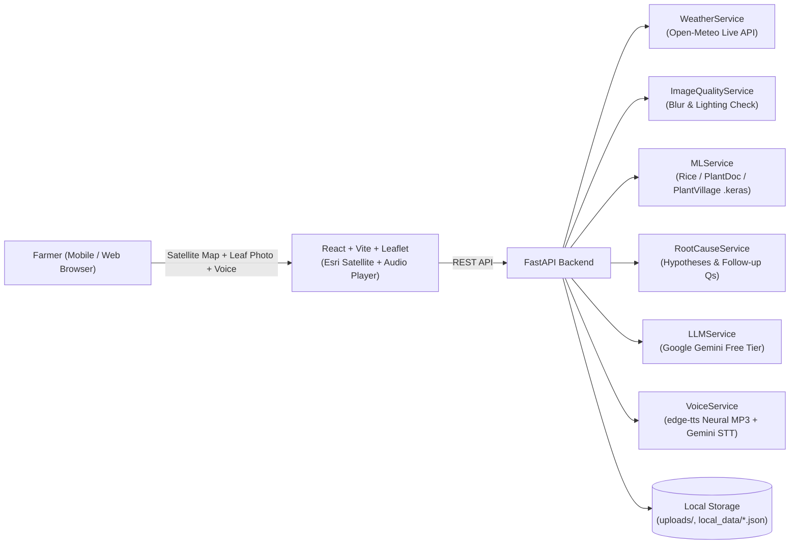
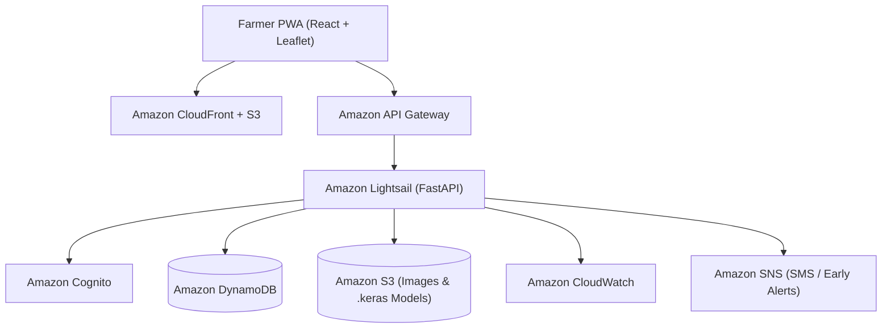
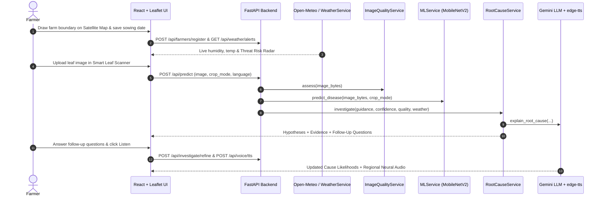
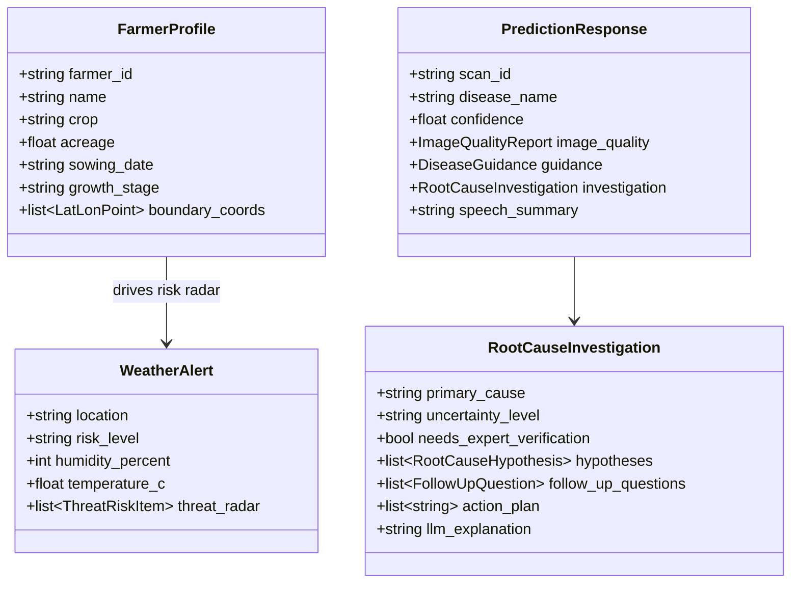
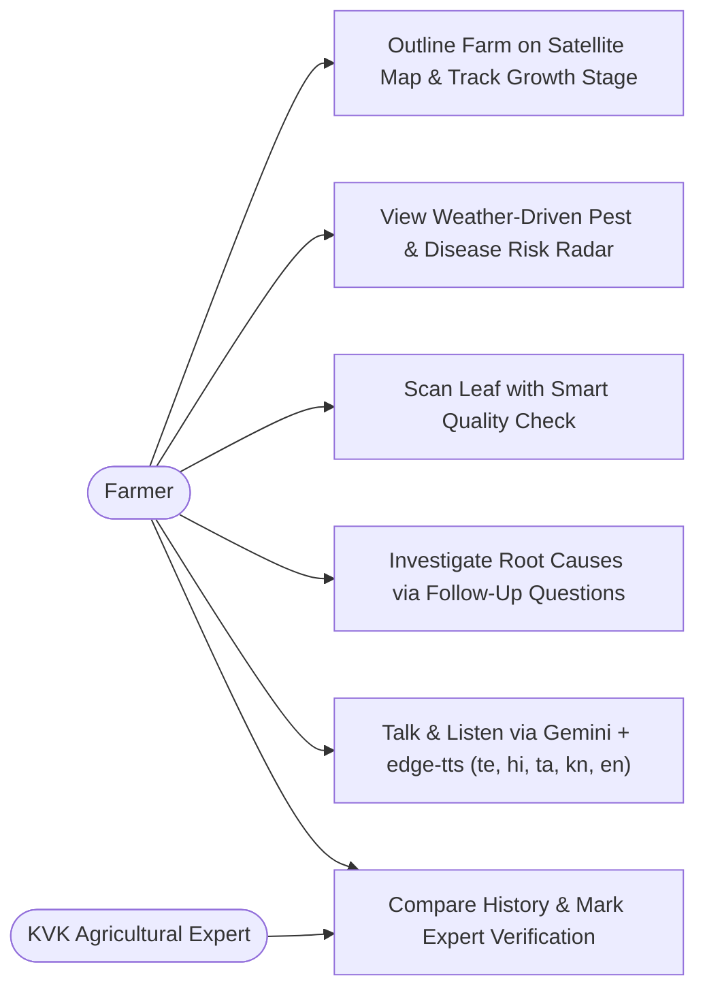

# KRISHI SAKHI AI — Predictive Crop Health & Root-Cause Intelligence Platform

> **Predict the risk. Investigate the cause. Explain the evidence. Guide the farmer.**
>
> *Farmer-friendly · Voice-first · Multilingual · Multi-crop*

**One-Line Pitch:** *Krishi Sakhi AI is an uncertainty-aware, multilingual crop health platform that combines live weather risk prediction, SmartScan leaf quality checks, MobileNetV2 disease classification, a RootCause Investigation Engine, and a Gemini-powered regional voice assistant to guide farmers in their native language.*

---

## Table of Contents

1. [Problem Statement & Objectives](#problem-statement--objectives)
2. [Core Platform Modules](#core-platform-modules)
3. [Technology Stack](#technology-stack)
4. [System Architecture](#system-architecture)
5. [UML Diagrams](#uml-diagrams)
6. [Project File Structure](#project-file-structure)
7. [Model Choice: Why MobileNetV2 & Transfer Learning](#model-choice-why-mobilenetv2--transfer-learning)
8. [Datasets, Training Process & Results](#datasets-training-process--results)
9. [Image Quality, Uncertainty & Explainability](#image-quality-uncertainty--explainability)
10. [API Endpoints & Error Contract](#api-endpoints--error-contract)
11. [Local Development & Commands Reference](#local-development--commands-reference)
12. [Limitations & Future Scope](#limitations--future-scope)
13. [Architecture Decision Records (ADRs)](#architecture-decision-records-adrs)

---

## Problem Statement & Objectives

Farmers face difficulties in identifying crop diseases and selecting appropriate disease-management methods due to limited access to reliable agricultural information and expert guidance. Dependence on neighbouring farmers, local pesticide distributors, and sellers often results in inconsistent recommendations and inappropriate pesticide usage. Language barriers and limited access to region-specific agricultural resources further restrict farmers from understanding disease symptoms, treatment options, preventive measures, and recommended farming practices.

### Key Objectives
- **Early Risk Prediction:** Monitor district weather (humidity, temperature, rainfall) and crop growth stage to flag disease risk *before* severe outbreaks.
- **Reliable Leaf Diagnosis:** Combine image quality validation (blur/exposure/resolution) with dedicated MobileNetV2 classifiers for Paddy, General Crops, and Field Photos.
- **Safe Pesticide & IPM Guardrails:** Prioritize organic/cultural management, provide verified chemical dosages, and explicitly warn against inappropriate pesticide mixes or seller misadvice (`do_not_do`).
- **Root-Cause Investigation:** Avoid jumping to a single blind label—compare Disease, Nutrient, and Pest hypotheses using supporting vs. conflicting evidence and farmer follow-up answers.
- **Region-Specific Resources & Multilingual Voice:** Connect farmers to regional KVKs, Rythu Bharosa Kendra / Rythu Vedika / Uzhavan / Raitha Samparka Kendra centers, and Kisan Call Center (`1800-180-1551`) alongside two-way **voice + chat** in **Telugu (`te`), Hindi (`hi`), Tamil (`ta`), Kannada (`kn`), and English (`en`)**.

---

## Core Platform Modules

| # | Module | Key Capabilities |
| :-: | :--- | :--- |
| **1** | **Farmer & Farm Registration** | Farmer profile, independent UI & chat language, Leaflet **Satellite Field Boundary** drawing, acreage calculation, crop, variety, sowing date, and automatic **crop growth-stage tracking**. |
| **2** | **Field Risk Radar & Early Warning** | Live **Open-Meteo** weather integration + crop-stage pest/disease risk prediction, **5-Day Safe Spray Window**, inspection reminders, and local farmer outbreak signals. |
| **3** | **Multi-Frame Smart Leaf Scanner** | Upload 1–3 leaf angles, **foliage presence gate** (`is_leaf_likely`), **blur/brightness/resolution quality check**, automatic best-frame selection, and **AI Lesion Attention Heatmap**. |
| **4** | **RootCause Investigation Engine** | Generates multiple hypotheses (Disease, Nutrient, Pest), compares **supporting vs. conflicting evidence**, identifies missing info, asks **dynamic follow-up questions**, and flags uncertainty for KVK expert verification. |
| **5** | **Explainable Diagnosis & Action Plan** | Plain-language explanation (enriched by Gemini LLM), safe treatment steps only when justified, and next-inspection schedule. |
| **6** | **Multilingual Krishi Sakhi Voice & Chat** | Context-aware **Gemini Free Tier LLM** chatbot + **`edge-tts`** neural regional speech output + **Gemini Audio STT** across **te, hi, ta, kn, en**. |
| **7** | **Crop Health History & Follow-up** | Local + offline (`localStorage`) scan history, before/after comparison, and KVK expert verification status. |

---

## Technology Stack

| Layer | Technology | Role |
| :--- | :--- | :--- |
| **Frontend** | React 19, Vite 6, CSS Design System | Mobile-first farmer UI, SVG quality gauges, offline `localStorage` cache |
| **Maps & Satellite** | Leaflet + Esri World Imagery + OpenStreetMap | Free satellite field boundary drawing & acreage calculation (no API key) |
| **Weather & Climate** | Open-Meteo Geocoding & Forecast API | Free real-time temp, humidity, rainfall, wind & Threat Risk Radar |
| **Backend** | Python 3.14, FastAPI, Pydantic v2, Uvicorn | Typed REST API, boundary validation, structured error contract |
| **AI / ML** | TensorFlow / Keras, MobileNetV2, Pillow, NumPy | Multi-dataset transfer learning & SmartScan image quality checks |
| **LLM Reasoning** | Google Gemini API (`gemini-flash-lite-latest`) | Natural multilingual farming advice, RootCause explanation, audio STT |
| **Voice Output (TTS)** | `edge-tts` Neural Voices + Browser Web Speech | Natural regional voices (`te`, `hi`, `ta`, `kn`, `en`) at \$0 cost |
| **Storage (Local)** | JSON files (`local_data/`) & `uploads/` | Zero-cost local persistence (migratable to AWS DynamoDB + S3) |
| **Testing** | Pytest + HTTPX | Automated API contract, voice, LLM, and RootCause verification |

---

## System Architecture

### Local-First Architecture (Current)



### Target Cloud Architecture (AWS Deployment Phase)



---

## UML Diagrams

### 1. Sequence Diagram — End-to-End Farmer Journey



### 2. Class Diagram — Core Services & Domain Models



### 3. Use Case Diagram



---

## Project File Structure

```text
Nexora/
├── README.md
├── .gitignore
├── docs/
│   └── decisions/
│       ├── ADR-001-local-first-architecture.md
│       ├── ADR-002-multi-model-strategy.md
│       └── ADR-003-free-maps-and-weather.md
├── training/
│   ├── requirements.txt
│   ├── 01_eda_and_prepare.py                   # Image verification & stratified split
│   └── 02_train_models.py                      # MobileNetV2 training, fine-tuning & eval
├── models/                                     # Exported .keras models & class_mapping.json
├── results/                                    # Confusion matrices, curves & evaluation_summary.json
├── backend/
│   ├── .env.example                            # Gemini API key template
│   ├── requirements.txt
│   ├── app/
│   │   ├── main.py                             # KRISHI SAKHI AI FastAPI entrypoint
│   │   ├── config.py                           # Paths, limits, env config & supported languages
│   │   ├── models/
│   │   │   └── schemas.py                      # Farm, Weather, SmartScan, RootCause, Voice & Chat schemas
│   │   ├── data/
│   │   │   └── disease_db.py                   # Verified disease knowledge base
│   │   ├── services/
│   │   │   ├── image_quality_service.py        # Blur, brightness & resolution assessment
│   │   │   ├── ml_service.py                   # Multi-model MobileNetV2 inference + fallback
│   │   │   ├── recommendation_service.py       # Verified guidance builder
│   │   │   ├── rootcause_service.py            # Multi-hypothesis RootCause Investigation Engine
│   │   │   ├── translation_service.py          # Multilingual localization (en, te, hi, ta, kn)
│   │   │   ├── weather_service.py              # Open-Meteo live weather & Threat Risk Radar
│   │   │   ├── llm_service.py                  # Google Gemini Free Tier LLM & audio STT
│   │   │   ├── voice_service.py                # edge-tts neural speech synthesis
│   │   │   └── assistant_service.py            # Context-aware multilingual chatbot
│   │   └── routers/
│   │       ├── farmers.py                      # Farm registration & growth-stage calculation
│   │       ├── weather.py                      # Risk Radar & local outbreak signals
│   │       ├── predict.py                      # Smart Leaf Scanner endpoint
│   │       ├── investigate.py                  # Dynamic follow-up refinement endpoint
│   │       ├── assistant.py                    # Krishi Sakhi AI chat endpoint
│   │       ├── voice.py                        # /api/voice/tts and /api/voice/stt endpoints
│   │       ├── history.py                      # Scan history & KVK expert verification
│   │       ├── diseases.py                     # Verified disease catalog
│   │       └── models_info.py                  # Loaded ML models status
│   └── tests/
│       └── test_api.py                         # Pytest API, LLM, Voice & RootCause suite
└── frontend/
    ├── package.json                            # React 19 + Vite + Leaflet
    └── src/
        ├── App.jsx                             # 5-stage farmer journey + offline localStorage cache
        ├── api.js                              # REST API, neural TTS & STT client
        ├── constants.js                        # Multilingual UI dictionary & crop/district presets
        ├── index.css                           # Emerald-forest theme & accessible styles
        └── components/
            ├── Navbar.jsx                      # Hero header, language selector & journey stepper
            ├── FarmRiskRadarPanel.jsx          # Leaflet Satellite Map + Farm Form + Risk Radar
            ├── SmartLeafScannerPanel.jsx       # SVG quality gauge + Leaf uploader
            ├── RootCausePanel.jsx              # Evidence comparison + Dynamic Q&A + Voice
            ├── AssistantChatPanel.jsx          # Multilingual Gemini Text & Voice Assistant
            └── CropHistoryPanel.jsx            # Before/After comparison + Expert verification
```

---

## Model Choice: Why MobileNetV2 & Transfer Learning

- **Lightweight & Edge-Friendly:** Uses depthwise separable convolutions and inverted residuals (~9–21 MB `.keras` files), enabling fast CPU inference on local servers or low-cost instances like Amazon Lightsail.
- **Transfer Learning:** Reuses ImageNet visual features (edges, leaf textures, lesion spots) instead of training from scratch, preventing overfitting on smaller datasets like UCI Rice (120 images) and PlantDoc (2,573 images).
- **Model Layer Stack (`224×224×3` RGB):**
  1. Training-only augmentation (`RandomFlip`, `RandomRotation(0.10)`, `RandomZoom(0.10)`, `RandomContrast(0.10)`)
  2. `Rescaling(1./127.5, offset=-1)`
  3. `MobileNetV2(weights="imagenet", include_top=False)`
  4. `GlobalAveragePooling2D` → `Dropout(0.30)` → `Dense(num_classes, activation="softmax")`
- **Training Configuration:** Adam optimizer, `sparse_categorical_crossentropy`, `EarlyStopping`, `ModelCheckpoint`, `ReduceLROnPlateau`, plus Stage-2 fine-tuning (last 30 layers unfrozen at `lr=1e-5`).

---

## Datasets, Training Process & Results

Rather than blindly merging incompatible taxonomies, we train **three separate specialist models**:

| Model Key | Dataset | Images | Classes | Split Strategy | Measured Test Accuracy | Measured Macro F1 |
| :--- | :--- | :---: | :---: | :--- | :---: | :---: |
| `rice` | Rice Leaf Diseases (UCI) | 120 | 3 | 70% / 15% / 15% | **72.22%** | **0.7167** |
| `plantdoc` | PlantDoc (Field Photos) | 2,573 | 28 | Official `test/`, 85/15 `train/val` | **43.22%** | **0.3978** |
| `plantvillage` | PlantVillage (Color) | 54,305 | 38 | 70% / 15% / 15% | *Training in progress* (Epoch 7 train acc: `96.30%`, Epoch 6 val acc: `94.48%`) | *Pending final eval* |

*Note on PlantDoc & UCI Rice:* PlantDoc contains noisy real-world backgrounds across 28 classes, while UCI Rice has only 40 images per class (18 test images total)—reporting these scores transparently avoids overstated lab-only metrics.

---

## Image Quality, Uncertainty & Explainability

- **SmartScan Quality Gate (`image_quality_service.py`):** Evaluates sharpness (finite-difference edge energy), brightness (too dark / overexposed), and resolution before diagnosis. Blurry or poorly lit images lower the `0–100` quality score and trigger retake guidance.
- **Uncertainty-Aware RootCause Engine (`rootcause_service.py`):** Flags `uncertainty_level = High` when confidence `< 60%` or image quality is unusable, and sets `needs_expert_verification = True` so farmers verify with a local **KVK agricultural officer** before applying strong chemicals.
- **Evidence Transparency:** Every diagnosis explains *why* a cause is suspected (supporting evidence) vs. *what is missing or conflicting*, and lets farmers refine likelihoods via 3 dynamic field questions.

---

## API Endpoints & Error Contract

All errors follow a consistent JSON contract:
```json
{
  "error": {
    "code": "VALIDATION_ERROR",
    "message": "Human-readable message",
    "details": []
  }
}
```

| Method | Endpoint | Description |
| :--- | :--- | :--- |
| `GET` | `/health` | Service health check |
| `POST` / `GET` | `/api/farmers` | Register farm with satellite boundary & growth stage |
| `GET` | `/api/weather/alerts` | Live Open-Meteo weather + Threat Risk Radar |
| `GET` / `POST` | `/api/weather/outbreaks` | Local farmer outbreak signals |
| `POST` | `/api/predict` | SmartScan quality check + MobileNetV2 + RootCause Investigation |
| `POST` | `/api/investigate/refine` | Re-score root causes from farmer follow-up answers |
| `POST` | `/api/assistant/chat` | Context-aware Gemini multilingual AI assistant |
| `POST` | `/api/voice/tts` | Neural MP3 speech synthesis (`edge-tts`) in `en, te, hi, ta, kn` |
| `POST` | `/api/voice/stt` | Multilingual audio transcription via Gemini Audio |
| `GET` / `PATCH` / `DELETE` | `/api/history` | Scan history, KVK verification, or clear |
| `GET` | `/api/diseases` | Verified disease knowledge base (with organic & `do_not_do` guardrails) |
| `GET` | `/api/diseases/resources/regional` | Region-specific KVK, RBK/RSK & Kisan Call Center (`1800-180-1551`) resources |
| `GET` | `/api/models/status` | Availability and metrics for loaded `.keras` models |

---

## Local Development & Commands Reference

### 1. Backend (FastAPI)

```bash
cd backend
cp .env.example .env   # Add your free GEMINI_API_KEY
python3 -m venv .venv
source .venv/bin/activate
pip install -r requirements.txt
python -m pytest -v
uvicorn app.main:app --reload --port 8000
```

### 2. Frontend (React + Vite + Leaflet)

```bash
cd frontend
npm install
npm run dev       # Development server on http://localhost:5173
npm run build     # Production build in frontend/dist/
```

### 3. Training Pipeline

```bash
cd training
python3 -m venv .venv && source .venv/bin/activate
pip install -r requirements.txt
python 01_eda_and_prepare.py
python 02_train_models.py
```

---

## Limitations & Future Scope

### Current Limitations
- **UCI Rice Sample Size:** Only 120 images (40/class); expanding with the 5,932-image Mendeley Rice dataset will improve field generalization.
- **No Grad-CAM Visual Heatmap Yet:** Explanations currently rely on image quality metrics, evidence cards, and Gemini LLM reasoning rather than pixel-level Grad-CAM overlays.
- **Local JSON Persistence:** Farmers, outbreaks, and scan history are stored in `backend/local_data/` for zero-cost local development.

### Future Scope
- **AI & Earth Observation:** Add **Grad-CAM** lesion overlays, **Sentinel-2 NDVI** vegetation health indices, and Mendeley Rice dataset fine-tuning.
- **Cloud & Scale:** Migrate local JSON/uploads to **AWS DynamoDB + S3 + Cognito + Lightsail** with **Amazon SNS** SMS alerts and **PostgreSQL + PostGIS** spatial queries.
- **Offline PWA:** Full Service Worker support for zero-connectivity rural scouting.

---

## Architecture Decision Records (ADRs)

- [ADR-001: Local-First Storage and Inference Architecture](docs/decisions/ADR-001-local-first-architecture.md)
- [ADR-002: Separate Multi-Model Training Strategy](docs/decisions/ADR-002-multi-model-strategy.md)
- [ADR-003: Free Public Maps and Weather APIs](docs/decisions/ADR-003-free-maps-and-weather.md)
